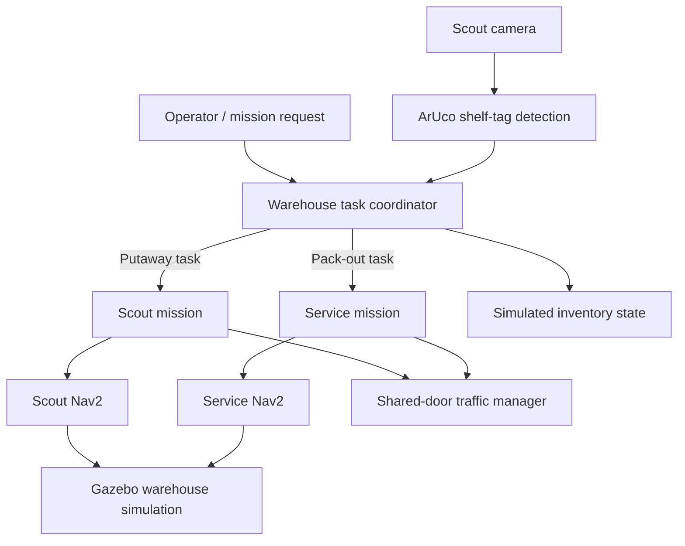

# RoamBot

**RoamBot is a ROS 2 warehouse-robotics simulation for exploring autonomous navigation, inventory workflows, task execution, and multi-robot traffic coordination.**

The project uses a custom differential-drive robot in Gazebo and Nav2 for navigation. It has grown from a single-robot navigation baseline into a two-robot warehouse workflow with Scout and Service roles. The active `feat/v3-warehouse-operations` branch develops task-oriented warehouse operations on top of that foundation.

## Demo video

[Watch the RoamBot warehouse demo](https://github.com/user-attachments/assets/219687f8-087e-4c82-be4c-8bf297d3dd17)

## Demo snapshots

<table>
  <tr>
    <td width="50%" align="center">
      
      <br />
      <sub>Custom differential-drive robot model</sub>
    </td>
    <td width="50%" align="center">
      
      <br />
      <sub>Scout inventory inspection</sub>
    </td>
  </tr>
  <tr>
    <td colspan="2" align="center">
      
      <br />
      <sub>Coordinated Scout and Service warehouse workflow</sub>
    </td>
  </tr>
</table>

> **Project status:** V3 warehouse operations are under active development. The current work includes named work poses, operation-specific Nav2 configuration, and visual tag-alignment experiments. Build and Python syntax checks have passed in the current development workspace; a complete end-to-end V3 runtime test is still to be confirmed.

## What RoamBot is building toward

A warehouse mission should be more than a robot moving to a coordinate. RoamBot separates the mission into understandable layers:

- **Simulation:** warehouse world, custom robot model, sensors, and ROS–Gazebo bridges.
- **Navigation:** localization, path planning, obstacle handling, and goal execution with Nav2.
- **Task execution:** named work poses and workflows such as putaway and pack-out.
- **Coordination:** Scout and Service requests, shared-doorway access, and task status.
- **Perception:** camera-based ArUco tag detection to confirm shelf identity.
- **Operator visibility:** a lightweight console and mission logs for observing what the system is doing.

## Architecture



This is the intended software architecture; not every V3 path has been validated end to end yet.

## Current capabilities and development status

| Area | Status | Details |
| --- | --- | --- |
| Custom differential-drive robot | Established baseline | URDF/Xacro robot description, Gazebo integration, and ROS 2 interfaces |
| Single-robot autonomy | Established baseline | Nav2, AMCL, map-based navigation, and Regulated Pure Pursuit |
| Two-robot simulation | Implemented in the project | Separate Scout and Service namespaces, robot-specific bridges, and navigation configuration |
| Inventory inspection | Existing workflow | Scout visits shelf inspection poses and uses camera-visible ArUco tags to identify shelves |
| Shared-door coordination | Existing workflow | Request/grant/release protocol reserves a doorway for one robot at a time |
| Mission console | Existing implementation | Tkinter GUI for inventory state, robot status, traffic state, route decisions, and event history |
| Named warehouse work poses | Active development | YAML-configured tasks with allowed-robot checks and optional heading derived from a target point |
| Warehouse operations missions | Active development | Scout putaway and Service pack-out workflows, task coordination, and inventory-state updates |
| Fine visual alignment | Experimental | Camera-based angular alignment to an expected ArUco tag |
| Path-planning comparison | Planned next research step | Compare a custom planning approach with the Nav2 baseline using repeatable metrics |
| Physical picking / replenishment with an arm | Future work | The current warehouse workflow does not yet demonstrate physics-based manipulation by a robot arm |

## Scout and Service roles

The warehouse-operations branch explores two task types:

- **Scout — putaway:** travel from the receiving area to a selected shelf, report task state, and return to its designated bay.
- **Service — pack-out:** travel to a shelf, represent a tote pickup, deliver it to a pack-out bay, and return to its designated bay.

The current simulation represents the inventory catalogue in software. A successful mission can update simulated quantities, but this does **not** mean boxes are physically detected, grasped, or moved by a simulated arm. That distinction is intentional and will remain explicit until perception and manipulation are implemented.

## Navigation and work-pose configuration

The navigation package contains warehouse-specific Nav2 parameter files, task pose definitions, and launch configurations. A named task can define:

- the target position;
- which robot is allowed to execute it;
- a fixed final heading, or a `face_point` that determines the heading toward a location.

The goal is to make warehouse tasks readable and repeatable rather than scattering coordinates across mission code.

## Repository layout

```text
roambot_ws/
└── src/
    ├── roambot_description/  # Robot URDF/Xacro model
    ├── roambot_simulation/   # Gazebo worlds, robot spawning, sensors and bridges
    ├── roambot_navigation/   # Nav2 configs, task poses and navigation helpers
    ├── roambot_perception/   # ArUco detection, missions, coordination and GUI
    └── roambot_bringup/      # Launch entry points for integrated workflows
```

## Requirements

- ROS 2 Jazzy
- Gazebo Harmonic (Gazebo Sim)
- Nav2 and `nav2_simple_commander`
- `ros_gz_sim` and `ros_gz_bridge`
- `slam_toolbox` for mapping workflows
- OpenCV with ArUco support and `cv_bridge`
- RViz2
- Python 3 and Tkinter for the Mission Console

RoamBot is developed with a resource-constrained Docker-based ROS 2 environment in mind. The two-robot Nav2 bringup is staged to reduce the initial load.

## Build from source

In a terminal where ROS 2 Jazzy is installed:

```bash
source /opt/ros/jazzy/setup.bash
mkdir -p ~/roambot_ws/src
cd ~/roambot_ws/src
git clone https://github.com/devwithchai/roambot.git
cd roambot
git switch feat/v3-warehouse-operations
```

If the repository is already cloned into `~/roambot_ws/src/roambot`, do not clone it again; use the existing checkout.

Build the workspace:

```bash
cd ~/roambot_ws
source /opt/ros/jazzy/setup.bash
colcon build --symlink-install --packages-up-to roambot_bringup
source install/setup.bash
```

For the active development branch, the same package build and Python syntax checks are the first validation step. Runtime launch validation is still required before treating a full V3 warehouse mission as verified.

## Existing inventory workflow

The repository contains an earlier GUI-driven inventory workflow. Its unified launch entry point is:

```bash
source /opt/ros/jazzy/setup.bash
cd ~/roambot_ws
source install/setup.bash
ros2 launch roambot_bringup warehouse_workflow.launch.py
```

This entry point belongs to the earlier Scout-inspection / Service-dispatch workflow. **Do not assume it launches every newer V3 warehouse-operations component.** The V3 launch integration is part of the current development work.

## Useful ROS interfaces

The existing inventory workflow uses topics under `/warehouse`, including:

| Topic | Purpose |
| --- | --- |
| `/warehouse/inspection_request` | Request a Scout inventory scan |
| `/warehouse/inspection_status` | Scout inspection state |
| `/warehouse/inventory_snapshot` | Simulated shelf inventory and tag-confirmation state |
| `/warehouse/inventory_request` | Request Service for a confirmed shelf |
| `/warehouse/service_state` | Service task state |
| `/warehouse/traffic_snapshot` | Door ownership and queued robots |
| `/warehouse/traffic_status` | Door request, grant and release events |
| `/scout/camera/image` | Scout camera stream |

Newer warehouse-operations nodes use additional interfaces under `/warehouse/operations`. Topics and launch files should be checked against the active branch before reusing commands from the earlier workflow.

## Validation checklist

Before calling a warehouse run successful, verify each layer independently:

1. **Build:** the required packages build and the launch files parse.
2. **Simulation:** Gazebo starts and each expected robot spawns.
3. **Navigation:** robot-specific localization and Nav2 action servers become active.
4. **Work pose:** the robot reaches the target position and final heading within the configured tolerances.
5. **Perception:** the expected shelf tag is actually visible and detected.
6. **Task outcome:** the coordinator records success only after the worker reports completion.
7. **Traffic:** a shared doorway is released only after the robot has cleared it.

A successful build proves that the software can be built; it does not by itself prove that navigation, tag detection, task execution, and traffic coordination work together at runtime.

## Roadmap

- [x] Custom robot model and single-robot Nav2 foundation
- [x] Two-robot warehouse workflow with inventory inspection and dispatch
- [x] Shared-door traffic coordination and operator-facing mission console
- [ ] Validate the V3 operation-specific launch and navigation configuration
- [ ] Complete repeatable putaway and pack-out mission tests
- [ ] Validate visual tag alignment at each intended shelf pose
- [ ] Compare path-planning approaches against a fixed Nav2 baseline
- [ ] Add benchmark logging for task success, travel distance, duration, wait time, and failures
- [ ] Explore robot-arm integration and physics-based pick/place tasks

## Development philosophy

RoamBot is intended to be an understandable robotics engineering project, not just a visual demo. The emphasis is on incremental integration, explicit task states, observable failure modes, repeatable experiments, and honest separation between simulated inventory logic and perception or manipulation that has actually been implemented.
